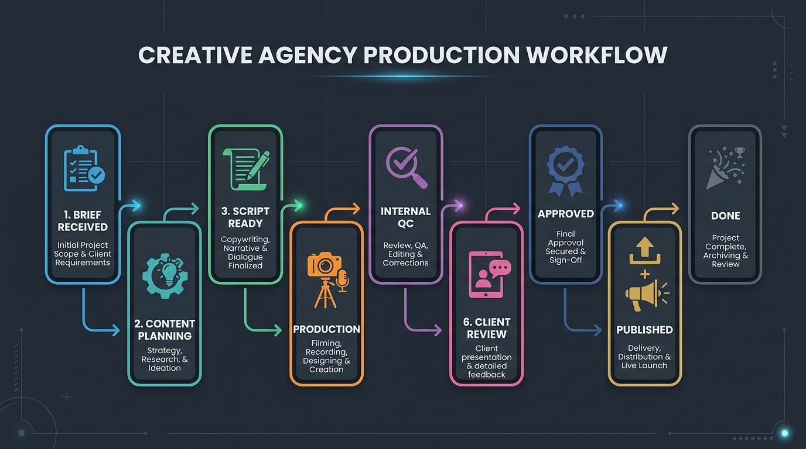

# LOCO TRACK

Sistem manajemen alur kerja dan handover proyek agensi kreatif dari tahap penerimaan brief, perencanaan konten, penulisan skrip, produksi aset, QC internal, review klien, hingga publikasi akhir.

---

## Daftar Isi

- [Akun Akses](#akun-akses)
- [Dokumen Acuan](#dokumen-acuan)
- [Fitur Utama](#fitur-utama)
- [Peran Pengguna](#peran-pengguna)
- [Alur Kerja Proyek](#alur-kerja-proyek)
- [Tech Stack](#tech-stack)
- [Struktur Direktori](#struktur-direktori)
- [Panduan Memulai](#panduan-memulai)
  - [Prasyarat](#prasyarat)
  - [Instalasi](#instalasi)
  - [Konfigurasi Environment](#konfigurasi-environment)
  - [Setup dan Import Database](#setup-dan-import-database)
  - [Inisialisasi Akun Admin](#inisialisasi-akun-admin)
  - [Menjalankan Aplikasi](#menjalankan-aplikasi)
- [Skrip dan Utilitas](#skrip-dan-utilitas)
- [Lisensi](#lisensi)

---

## Akun Akses

Daftar akun uji coba bawaan (_seed data_) yang siap digunakan untuk pengujian alur kerja sistem sesuai dengan definisi peran (`user_role`) pada `supabase/production_schema.sql` dan data awal pada `supabase/seed.sql`.

### Detail Akun & Email Sistem

| Role Sistem (`user_role`) | Peran / Posisi          | Nama Pengguna | Username | Email                   | Password   |
| :------------------------ | :---------------------- | :------------ | :------- | :---------------------- | :--------- |
| `ADMIN`                   | Administrator           | Administrator | `admin`  | `admin@locotrack.local` | `12345678` |
| `CREATIVE_DIRECTOR`       | Creative Director       | Putri         | `putri`  | `putri@locotrack.local` | `12345678` |
| `SOCIAL_MEDIA_SPECIALIST` | Social Media Specialist | Naja          | `naja`   | `naja@locotrack.local`  | `12345678` |
| `SOCIAL_MEDIA_SPECIALIST` | Social Media Specialist | Amel          | `amel`   | `amel@locotrack.local`  | `12345678` |
| `GRAPHIC_DESIGNER`        | Graphic Designer        | Farel         | `farel`  | `farel@locotrack.local` | `12345678` |
| `VIDEO_EDITOR`            | Video Editor            | Rafli         | `rafli`  | `rafli@locotrack.local` | `12345678` |

**Catatan Akun Uji Coba Tambahan:**

- **Akun Nonaktif (Uji Keamanan):** `inactive@locotrack.local` (Username: `inactive`, Nama: _Ian Inactive_, Role: `GRAPHIC_DESIGNER`) dengan status `is_active = false` untuk pengujian validasi penolakan login pengguna yang dinonaktifkan.
- **Kustomisasi Akun:** Informasi akun dan hak akses dapat dikonfigurasi kembali oleh Administrator melalui menu Manajemen Pengguna atau diinisialisasi melalui skrip `scripts/bootstrap-admin.ts`.

---

## Dokumen Acuan

Pengembangan dan alur kerja aplikasi ini mengacu pada dokumen spesifikasi [TRACKER BRIEF.pdf](TRACKER BRIEF.pdf). Dokumen ini memuat dasar kebutuhan sistem, pembagian peran, dan tahapan produksi konten di agensi.

---

## Fitur Utama

- **Manajemen Klien dan Brand**: Pengelolaan hierarki klien dan banyak brand dalam satu dashboard.
- **Brief Kreatif dan Content Plan**: Form pencatatan brief ide kreatif serta penentuan timeline editorial.
- **Penyusunan Skrip**: Kolaborasi naskah konten dengan alur revisi dan persetujuan bertingkat.
- **Kanban Task dan Kesiapan Produksi**: Visualisasi status pekerjaan desain grafis, editing video, dan copywriting dengan indikator kesiapan produksi.
- **Deliverables dan Storage**: Upload serta pengelolaan file final yang terhubung langsung ke Supabase Storage.
- **QC Internal dan Review Klien**: Modul pengecekan kualitas sebelum materi diajukan ke klien, lengkap dengan riwayat revisi.
- **Monitoring Tim dan Deadline**: Pantau beban kerja anggota tim dan batas waktu tugas agar pekerjaan selesai tepat waktu.
- **Pusat Notifikasi dan Log Aktivitas**: Notifikasi otomatis di dalam aplikasi dan pencatatan riwayat setiap aksi.

---

## Peran Pengguna

Daftar peran yang tersedia di dalam sistem:

| Role                          | Deskripsi Singkat      | Wewenang Utama                                                                 |
| :---------------------------- | :--------------------- | :----------------------------------------------------------------------------- |
| **`ADMIN`**                   | Administrator Sistem   | Mengelola seluruh pengguna, konfigurasi brand dan klien, serta akses sistem.   |
| **`CREATIVE_DIRECTOR`**       | Pengarah Kreatif       | Menyetujui brief, memimpin review QC, dan approval akhir deliverable.          |
| **`ACCOUNT_EXECUTIVE`**       | Penghubung Klien       | Menginput brief, mengelola komunikasi dengan klien, dan mencatat hasil review. |
| **`SOCIAL_MEDIA_SPECIALIST`** | Spesialis Media Sosial | Menyusun perencanaan konten, copywriting, dan jadwal publikasi.                |
| **`GRAPHIC_DESIGNER`**        | Desainer Grafis        | Mengerjakan aset visual grafis sesuai brief dan catatan revisi.                |
| **`VIDEO_EDITOR`**            | Editor Video           | Memproduksi materi video dan mengunggah hasil deliverable.                     |

---

## Alur Kerja Proyek



1. **`BRIEF_RECEIVED`**: Brief kreatif diterima dari klien.
2. **`CONTENT_PLANNING`**: Perencanaan konsep, tema, dan jadwal rilis.
3. **`SCRIPT_READY`**: Skrip selesai ditulis dan siap diproduksi.
4. **`PRODUCTION`**: Tim kreatif mengerjakan materi desain atau video.
5. **`INTERNAL_QC`**: Pengecekan kualitas oleh tim internal dan Creative Director.
6. **`CLIENT_REVIEW`**: Materi diajukan ke klien untuk disetujui atau diberi revisi.
7. **`APPROVED`**: Aset disetujui tanpa catatan revisi.
8. **`PUBLISHED`**: Konten berhasil dipublikasikan di kanal terkait.
9. **`DONE`**: Serah terima selesai secara administratif.

---

## Tech Stack

- **Framework**: [Next.js 16](https://nextjs.org/) (App Router dan Server Actions)
- **Frontend**: [React 19](https://react.dev/), [TypeScript 5](https://www.typescriptlang.org/)
- **Styling**: [Tailwind CSS v4](https://tailwindcss.com/), Radix / Base UI, [shadcn/ui](https://ui.shadcn.com/)
- **Database & Backend**: [Supabase](https://supabase.com/) (PostgreSQL, Row-Level Security, Auth, Storage, Edge RPC)
- **State & Tables**: TanStack Table v9, Lucide Icons
- **Form & Validasi**: React Hook Form, [Zod](https://zod.dev/)

---

## Struktur Direktori

```text
├── public/                 # File aset statis
├── scripts/                # Skrip utilitas, bootstrap admin, dan pengujian
├── src/
│   ├── app/                # Next.js App Router
│   │   ├── (auth)/         # Halaman login dan reset password
│   │   └── (dashboard)/    # Halaman dashboard (projects, tasks, team, users, dll.)
│   ├── components/         # Komponen UI bersama
│   ├── features/           # Modul fitur berbasis domain
│   │   ├── activity/       # Activity feed dan logging
│   │   ├── approvals/      # Alur persetujuan
│   │   ├── brands/         # Manajemen brand
│   │   ├── briefs/         # Form brief kreatif
│   │   ├── client-review/  # Review dan catatan klien
│   │   ├── clients/        # Manajemen klien
│   │   ├── content-plans/  # Jadwal dan rencana konten
│   │   ├── dashboard/      # Ringkasan statistik dan metrik
│   │   ├── deliverables/   # Upload file dan serah terima
│   │   ├── notifications/  # Pusat notifikasi
│   │   ├── projects/       # Detail dan daftar proyek
│   │   ├── scripts/        # Penyusunan skrip
│   │   ├── tasks/          # Kanban task dan progres kerja
│   │   ├── team/           # Pantauan beban kerja tim
│   │   └── users/          # Manajemen user dan role
│   ├── lib/                # Konfigurasi Supabase dan fungsi helper
│   └── types/              # Definisi tipe TypeScript
└── supabase/
    ├── migrations/         # File migrasi database SQL
    └── seed.sql            # Data awal untuk keperluan lokal
```

---

## Panduan Memulai

### Prasyarat

- [Node.js](https://nodejs.org/) versi 20 ke atas
- [npm](https://www.npmjs.com/)
- [Supabase CLI](https://supabase.com/docs/guides/cli) (opsional jika menjalankan database lokal)

### Instalasi

1. Clone repository:

   ```bash
   git clone <URL_REPO_ANDA>
   cd handover-tracker
   ```

2. Pasang paket dependensi:
   ```bash
   npm install
   ```

### Konfigurasi Environment

Salin file `.env.example` ke `.env.local`:

```bash
cp .env.example .env.local
```

Sesuaikan nilai variabel berikut di `.env.local`:

```ini
NEXT_PUBLIC_SUPABASE_URL=http://127.0.0.1:54321
NEXT_PUBLIC_SUPABASE_ANON_KEY=your_supabase_anon_key

SUPABASE_SERVICE_ROLE_KEY=your_supabase_service_role_key

# Opsional untuk menjalankan script bootstrap admin:
ADMIN_EMAIL=admin@example.com
ADMIN_PASSWORD=your_secure_password
ADMIN_NAME=System Administrator
```

### Setup dan Import Database

Seluruh skema database sudah diekspor dan tersedia di repository ini agar developer selanjutnya dapat langsung mengimpor tanpa konfigurasi manual dari awal.

#### Berkas Database yang Tersedia

- `supabase/production_schema.sql`: Satu file skema kompilasi utuh berisi seluruh enum, tabel relasional, triggers, fungsi database, RLS (Row Level Security), dan kebijakan Supabase Storage.
- `supabase/migrations/`: Kumpulan 31 file migrasi berurutan untuk alur kerja Supabase CLI lokal.
- `supabase/seed.sql`: Data akun uji coba untuk seluruh peran pengguna (password default: `12345678`).
- `scripts/dummy-test-data.sql`: Data sampel untuk klien, brand, dan proyek awal.

#### Pilihan 1: Import ke Supabase Cloud

1. Buka dashboard project di [Supabase](https://supabase.com).
2. Masuk ke menu SQL Editor.
3. Salin isi file `supabase/production_schema.sql`, tempel di editor, lalu jalankan (Run).
4. Jika membutuhkan akun pengujian awal, jalankan juga file `supabase/seed.sql`.

#### Pilihan 2: Import ke Supabase Lokal (CLI)

Jika menjalankan Supabase secara lokal dengan Docker:

```bash
npx supabase start
npx supabase db reset
```

Perintah `db reset` akan otomatis menerapkan seluruh migrasi di `supabase/migrations/` dan mengisi data awal dari `supabase/seed.sql`.

### Inisialisasi Akun Admin

Jalankan skrip berikut untuk membuat akun admin pertama:

```bash
npx tsx scripts/bootstrap-admin.ts
```

### Menjalankan Aplikasi

Jalankan server development:

```bash
npm run dev
```

Buka [http://localhost:3000](http://localhost:3000) di browser.

---

## Skrip dan Utilitas

Beberapa perintah yang tersedia di project ini:

| Perintah                                   | Keterangan                                          |
| :----------------------------------------- | :-------------------------------------------------- |
| `npm run dev`                              | Menjalankan server development                      |
| `npm run build`                            | Membuat build production                            |
| `npm run lint`                             | Menjalankan pemeriksaan kode dengan ESLint          |
| `node scripts/gen-types.cjs`               | Generate tipe TypeScript dari schema Supabase lokal |
| `npx tsx scripts/bootstrap-admin.ts`       | Inisialisasi akun Admin pertama                     |
| `npx tsx scripts/verify-database.ts`       | Verifikasi struktur tabel dan relasi database       |
| `npx tsx scripts/smoke-production-full.ts` | Uji coba alur kerja produksi secara menyeluruh      |

---

## Lisensi

Didistribusikan untuk keperluan internal agensi.
